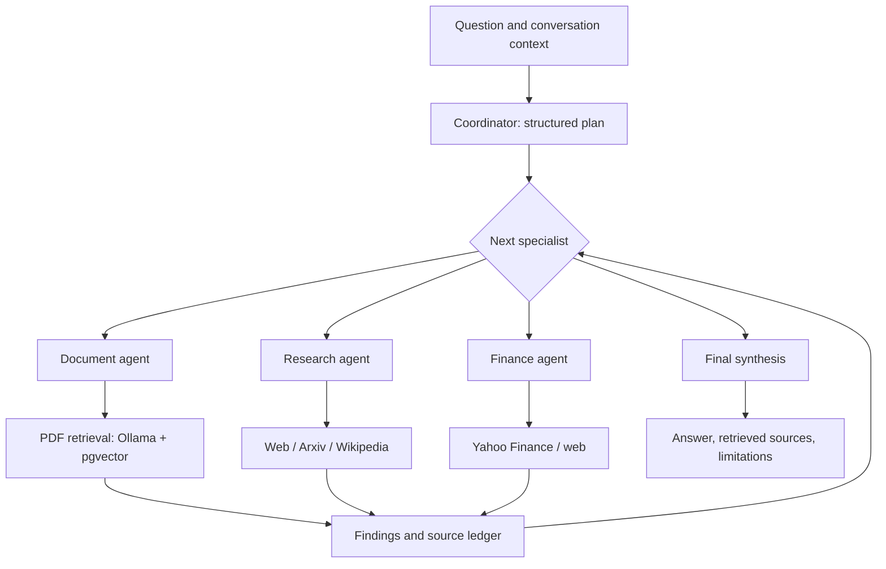

# Multi-Agent PDF RAG, Research & Financial Analysis Assistant

A LangGraph application that brings PDF retrieval, research search, and financial data tools into one command-line assistant. A coordinator selects document, research, and finance specialists; their findings are combined into a response with source references and reported limitations.

Built by Ayushditya Ranjan from three independent prototypes: a pgvector PDF assistant, a research tool-calling notebook, and a finance agent team.

## Implemented capabilities

| Specialist | Tools and behavior |
|---|---|
| Documents | Local PDF ingestion, Ollama embeddings, PostgreSQL/pgvector cosine retrieval, page references, collection isolation |
| Research | Web search through Tavily or DuckDuckGo, Arxiv abstracts, Wikipedia extracts |
| Finance | Yahoo Finance quotes, company fundamentals, analyst recommendation summaries, company news, web context |
| Coordinator | Structured task planning, sequential delegation to up to three specialists, shared findings, final synthesis |

Ollama runs chat and embeddings locally. Groq is an optional chat provider; embeddings still run through Ollama. Each specialist has a bounded tool loop. Tool failures are reported without exposing credentials. A retrieved-source ledger is printed independently of model-generated citations. Unknown citation IDs are flagged.

## Architecture



The coordinator calls each selected specialist once. Each specialist runs its own LangGraph tool loop, with at most four reasoning turns and eight tool calls by default. Later specialists receive earlier findings, allowing a PDF result to inform a subsequent research or finance task. The application performs information retrieval and analysis; it executes no trades.

## Setup

Requires Python 3.11+, [uv](https://docs.astral.sh/uv/), [Ollama](https://ollama.com/), and Docker Desktop for the supplied PostgreSQL service.

```bash
uv sync --locked
cp .env.example .env
```

Set a local database password in `.env`, updating both `POSTGRES_PASSWORD` and `DATABASE_URL`. The example password is for local setup only. The PostgreSQL port is bound to localhost.

```bash
docker compose up -d
ollama pull llama3.2
ollama pull nomic-embed-text
uv run multi-assistant doctor
```

Ollama must be running. Set `CHAT_MODEL` to an installed model that supports tools and structured JSON output. Set `EMBEDDING_DIMENSIONS` to match the embedding model. The default `nomic-embed-text` configuration uses 768 dimensions.

For Groq, set `MODEL_PROVIDER=groq`, `GROQ_API_KEY`, and a supported `CHAT_MODEL`. For Tavily, set `TAVILY_API_KEY`; otherwise web search uses DuckDuckGo. Environment variables override the selected `.env` file.

## Usage

Index a PDF that you have permission to process:

```bash
uv run multi-assistant ingest /path/to/document.pdf
uv run multi-assistant documents
uv run multi-assistant retrieve "What revenue does the report disclose?"
uv run multi-assistant ask "Summarize the main findings in the indexed PDFs."
```

Research and finance:

```bash
uv run multi-assistant ask "Find Arxiv papers about retrieval augmented generation."
uv run multi-assistant ask "Show MSFT fundamentals and recent company news."
uv run multi-assistant ask "Compare the indexed company report with recent news." --agents documents,research
uv run multi-assistant ask "Retrieve MSFT's quote and explain market capitalization." --agents finance,research --json
uv run multi-assistant chat
```

`--agents` explicitly selects specialists and bypasses coordinator planning. It helps reproduce a workflow or recover from an unsuitable plan. `--json` exposes task plans, specialist findings, retrieved evidence, tool counts, warnings, and source metadata. Interactive chat retains the last five exchanges in memory for the current process; messages and specialist findings are shortened before model calls to bound context.

PDF tools are disabled when `DATABASE_URL` is unset, so research and finance can run without PostgreSQL. Ingestion is an explicit command; importing modules does not index documents or run queries. PDF documents are identified by their content hash, making re-ingestion of the same file idempotent. An edited file is a separate document version. Use `PDF_COLLECTION` to separate document sets. Collections are logical filters, not authentication boundaries.

## Data handling and limitations

- PDF text and embeddings are stored in your configured PostgreSQL database. Chat history stays in process memory. This repository contains no private PDFs, original notebook outputs, datasets, or credentials.
- Groq receives chat prompts, including document excerpts used in answers. Research queries go to external search providers. Ollama inference alone does not make the complete application offline.
- Retrieval uses text extraction and cosine similarity. Scanned PDFs require OCR outside this application. Encrypted PDFs are unsupported. The current ingestion limits are 50 MB and 5,000 chunks per PDF.
- Research tools retrieve abstracts, extracts, and search snippets. They do not read arbitrary full papers or full web pages. Service availability, quotas, and rate limits affect results.
- Yahoo Finance fields can be missing or delayed. Retrieval timestamps and available market timestamps are included; live prices are not guaranteed.
- A source reference confirms which evidence was retrieved. It does not automatically verify that every generated claim is supported. Model answers and financial interpretations require review.
- The current application is a CLI prototype with in-memory conversation context. Persistent sessions, a web interface, authentication, and production deployment are not implemented.

## Verification

```bash
uv run pytest -q
uv run ruff check .
uv run ruff format --check .
# Uses a configured test database and running Ollama; creates and removes its own collection.
RUN_INTEGRATION=1 uv run pytest -q tests/test_integration.py
```

Offline tests exercise multi-specialist delegation, evidence handoff, context, tool failures, execution budgets, citation handling, PDF chunking, and configuration. The opt-in integration test checks real PDF ingestion, pgvector retrieval, collection isolation, and idempotent re-ingestion. See [validation notes](docs/VALIDATION.md) for recorded live results.

## Repository layout

```text
src/multi_assistant/
  config.py       Model and environment configuration
  documents.py    PDF extraction, embeddings, and pgvector persistence
  tools.py        Research, finance, and document tool adapters
  agents.py       Bounded specialist LangGraph workflows
  graph.py        Coordinator, delegation, synthesis, and source rendering
  evidence.py     Source and evidence schemas
  cli.py          Ask, chat, ingest, retrieve, inventory, and service checks
tests/            Offline tests and opt-in pgvector integration test
docs/             Migration notes and validation evidence
compose.yaml      Local PostgreSQL/pgvector service
uv.lock           Reproducible dependency resolution
```

## Technical references

The graph and tool-loop implementation follows the [LangGraph Graph API quickstart](https://docs.langchain.com/oss/python/langgraph/quickstart). Provider configuration uses the official [ChatOllama](https://docs.langchain.com/oss/python/integrations/chat/ollama) and [ChatGroq](https://docs.langchain.com/oss/python/integrations/chat/groq) integrations. Database retrieval uses [pgvector cosine distance](https://github.com/pgvector/pgvector) through psycopg.
